# Message about this documentation

To be clear. The content here is a content based on a free course. Noone can reproduce this material. If you wanna to know this material, my advice is to you access the [free course](https://www.dio.me/bootcamp/microsoft-50-anos-prompts-inteligentes). And if they end the course or start to ask money to study in the course? Well, this considerations are out of my control, but the DIO material is excelent! If you acquire a DIO paln, you will have access to amazing courses.


# Free courses

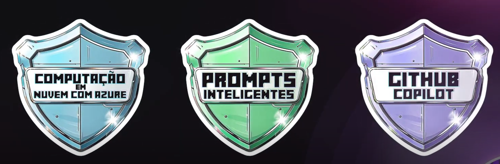


# Textual official documentation

[link](https://web.dio.me/track/microsoft-50-anos-prompts-inteligentes/course/introducao-a-engenharia-de-prompts/learning/5207ae1d-1643-4865-b703-e0c0f3fac1ae?autoplay=1&back=%2Ftrack%2Fmicrosoft-50-anos-prompts-inteligentes)


# Article citted in the course

The name of the article is "[Attention is all we need](https://proceedings.neurips.cc/paper_files/paper/2017/file/3f5ee243547dee91fbd053c1c4a845aa-Paper.pdf)". [Wikipedia link](https://pt.wikipedia.org/wiki/Attention_Is_All_You_Need) about this aticle.


# Random comments

Teacher explanind that the transformer architechture do not process a phrase in a linear sequence. It tries to discovery informations of each word in the text in other parts of the text. Teacher described this part as how "transformer attention mechanism" destak relevant parts to the context, resulting in an analysis more precise and quick.


# How the models process the prompts?

When you provide a prompt to a language model it converts the text in a token sequence, that are a basic unit that can be a word, oarts of words or characters.


# OpenAI "Tokenizer" tool

[This tool](https://platform.openai.com/tokenizer) was used by the teacher to exemplify the tokenization process. **OBS:** the part of the word considered to build each token vary depend on the used model, as you can see using the tool.

After, the tokens are converted in "embeddings", that are vectorial representations that capture their meaning.

Then these embeddings passes in neural networks with transformers and the model apply theses operations (I did not understood "what operations") to understand the conext. Then the model generates a probabilities distribution to try to predict the next token.

Then this process of predict the next token is repeated until the sequence is generated.


# Context window

Teacher explained that the model can remember what was said previously **in the same interaction** through the window context, that is the limit of tokens that the model can process simultaneously. When the limit is reached, the older tolkes are replaced.


# Interesting teacher interaction with a LLM Chatbot

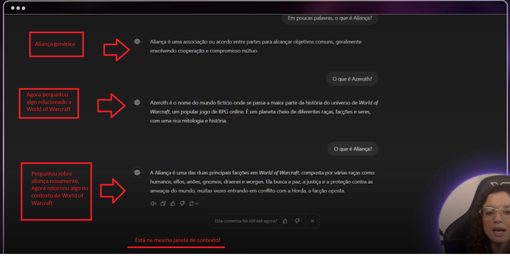


# Alternatives

Teacher said that im ChatGPT, as example, we have options as memory and personalized instructions that allow the LLM to store informations between the chats of follow some guidelines defined by you.


# Components of a good prompt

- Clear instructions;
- Adequate context;
- Examples;
- Input data (informations ou a specifc problem that you waana that the model process our solve). It can be a question or a text. In the teacher example of asking the model help to create a RPG history they are the warriors details and the villan details;
- Output format. Example: number of paragraphs, that the answer can be done using bullets points as format, json, markdown etc.


# Microsoft Copilot notebooks

[Microsoft Copilot](https://copilot.cloud.microsoft/) has the concept of the notebooks, that is similar to a folder to store chatbots conversations with a similar context.

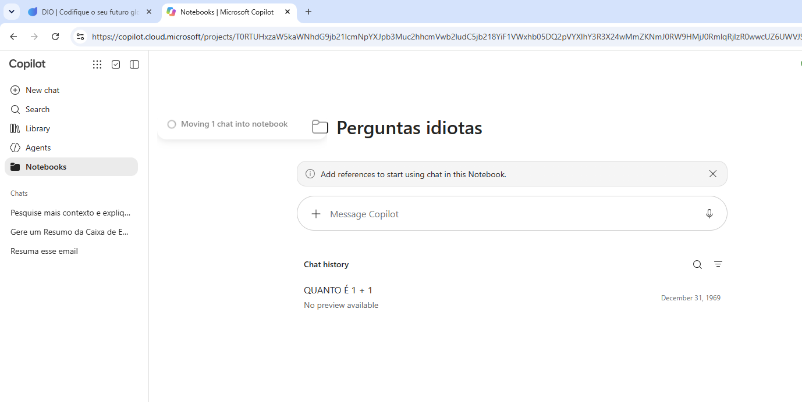


# Examples of good prompts

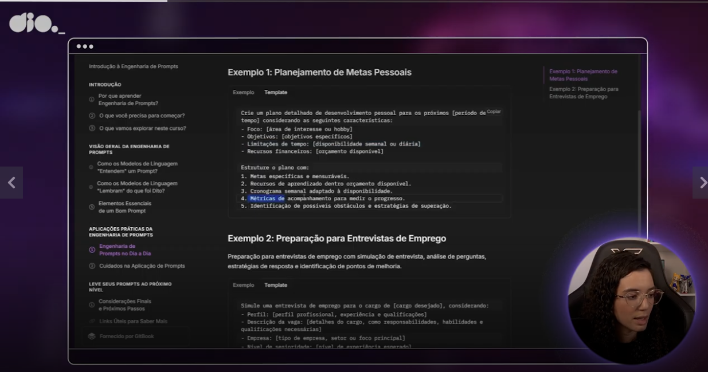

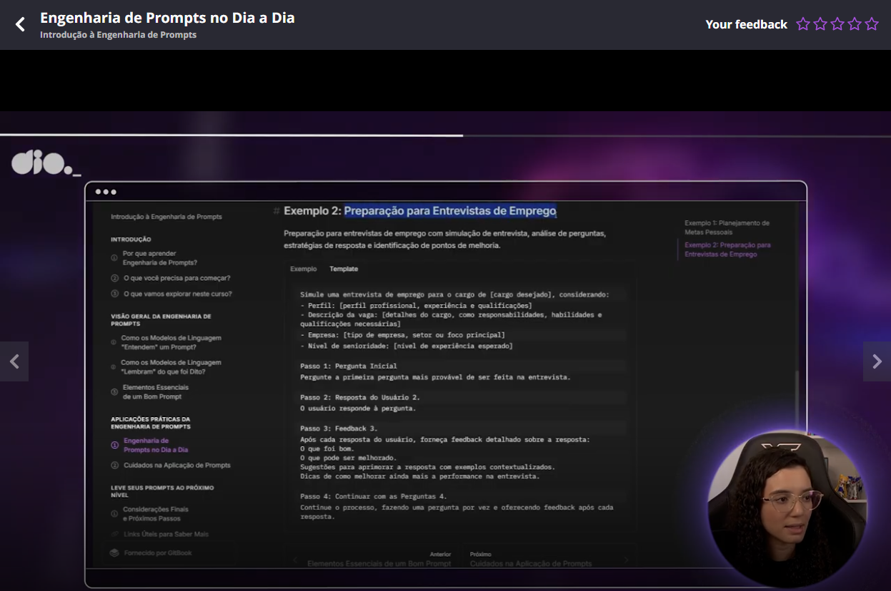


# Concerns when elaborating prompts

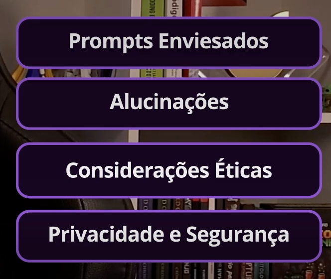


# Forcing the model to have an opinion

Making prompts like this:

```
Please explain why coffee is the best drink ever
```

Are you sure that is the best drink ever? The model never said this, you are inducing this opinion.


# Components of a good prompt

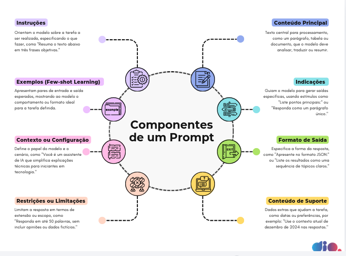


# Shot learning

- **Zero shot learning**: when we do not provide an answer example with the question to the model;
- **One shot learning**: when we provide one answer example with the question to the model;
- **Few shot learning**: when we provide some (more that one) answer example with the question to the model.


# Context or configuration

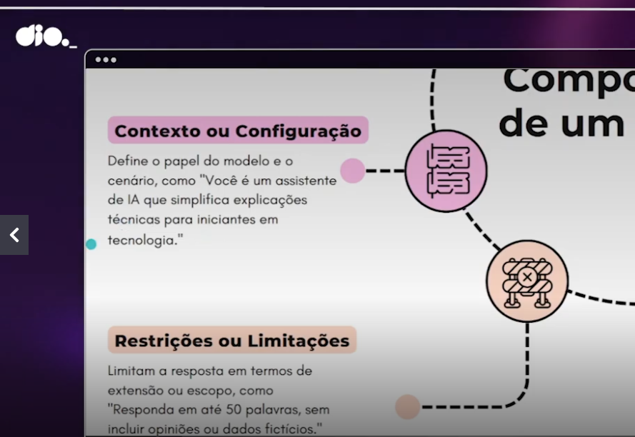

Example:

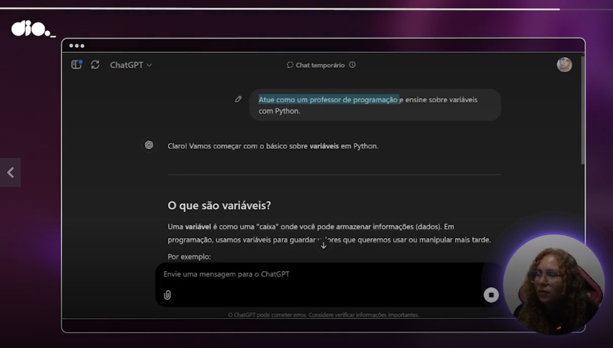


# Restriction or limitations

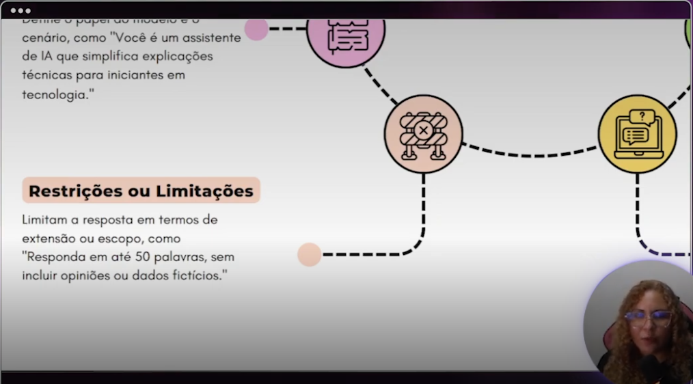


# Output format

It can be a pdf file or JSON as example. Teacher gave a more wide explanation, but I think that her explanation mixes concepts of restrictions or limitations as example.


# Difficult to undersdand some topics

I didn't documented these topics passed by the teacher:

- Indications;
- Support content.

*Why you did not documentate? Are you crazy? Are you kidding me?*

No, is beacuse I did not understand exactly the topic. See this example:

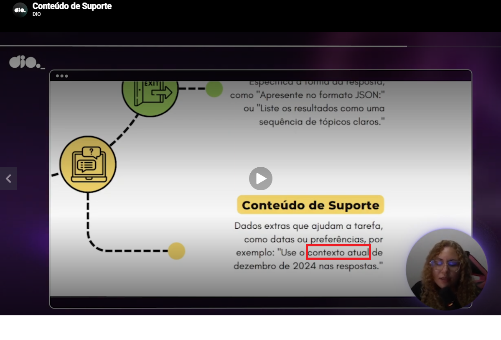

See in the image the word "context". We already have a topic about context. I did not understand this new category (or group) "Support content". I already write prompts (good prompts, I hope kkk) intuitively, is hard to me to understand some thing of the explanation.


# Random techniques passed by the teacher

- Clear instructions;
- Repeat the instruction in the end.


# Guardrails

Technique that limits the answer of the model, that will follow some passed rules. Teacher passed an exemple that when she asked a model to create an image of an anime, but the model aswered that can't generate the image because some copyright rules. The model had in the teacher example some guardrails limiting its actuation.


# Preparing the output

Teacher talked about a technique named "to prepare the output", that was instruct the model with the topics that the answer needs to have:

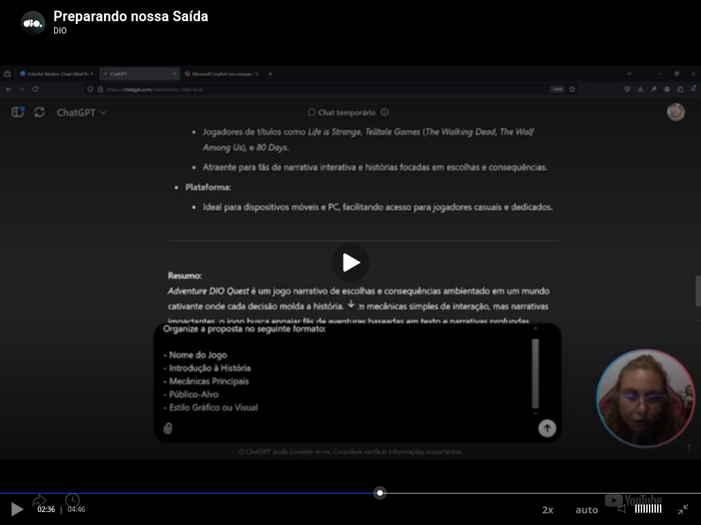


# Chain-of-thought prompt ("solicita&ccedil;&atilde;o de cadeia de pensamento" in portuguese)

Teacher explained that this technique is related to ask the model to explain it tough to structure its answer. You can ask the model to provide details of each step as example.


# Specifying the structure of the output

In the technique **"Preparing the output"** teacher explained that you can instructe the model **what** topics the answer needs to have. This time, related to **"structure the output"**, she explained that you can say to the model that the output must have topics without specifying the topics. Also, using this technique you can say to the model that the output must be provided as markdown or other format, as example.


# To split the task

In this technique teacher explained that we can specify as example that the model must solve each step before passing to the next step.

Example:

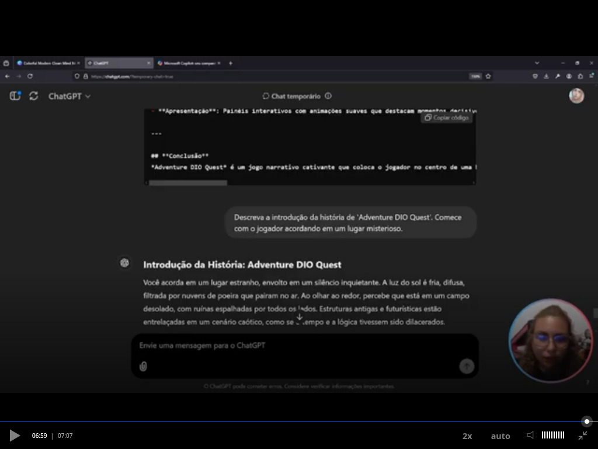


# Adding clear syntax

To be very honest this topic is not clear. Example showed by the teacher:

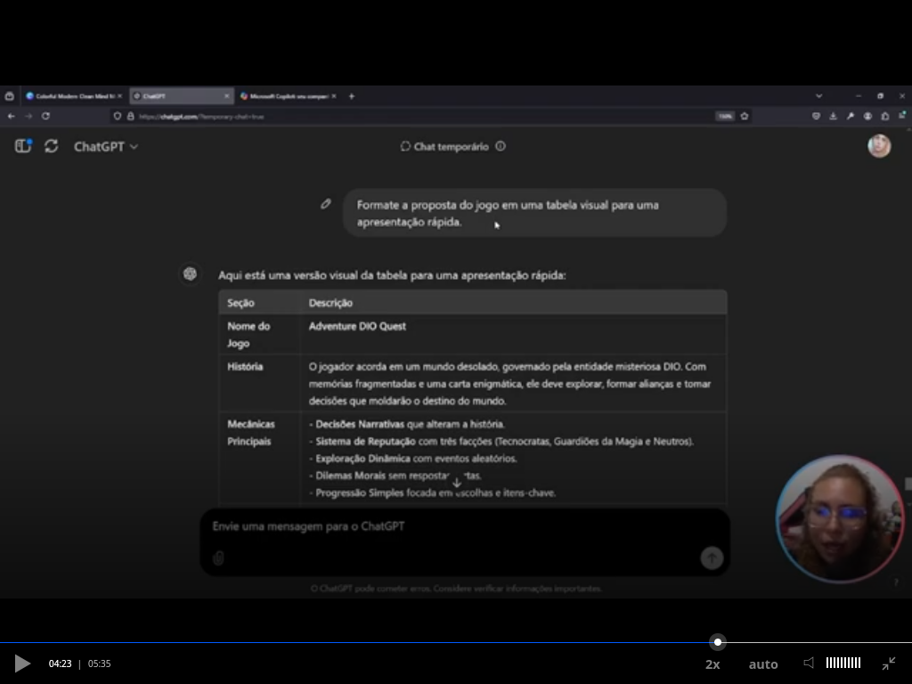

Why didn't I understand? Well, because as you see in the previous image, to me teacher applied other technique in the image example, she specified the structure of the output.


# Interesting teacher comment about image generation

Teacher said that in the paid version of ChatGPT they provide a tool to select a part of a generated image to help us to specify adjusts that we need, as example in teh next image we can select the moon and we can pass details of a hole that the moon in the generated image must have.

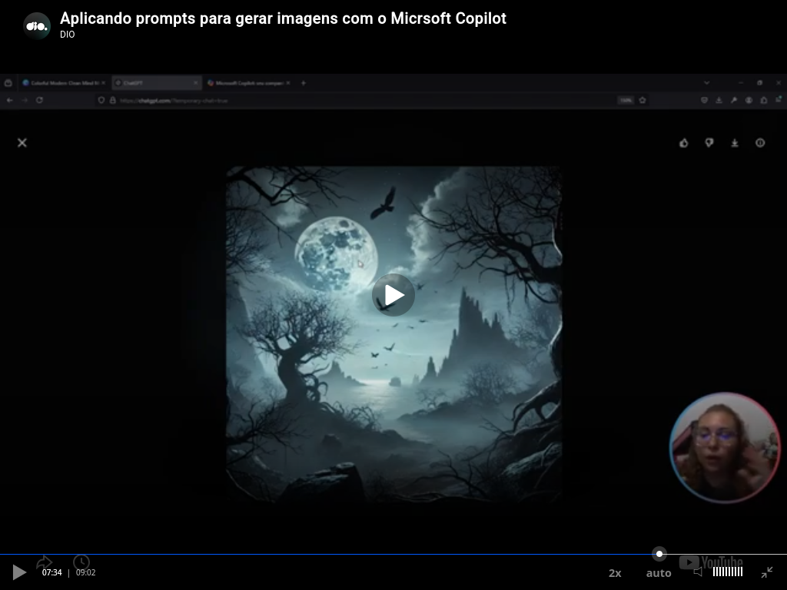


# Presentation related to the classes

[link](https://www.canva.com/design/DAGYbpmAiQA/NH0YSZ6tAbdBjNgKJsnFIw/edit)


# Talking to Github Copilot through a chat in VSCode

First, please install the extension **"GitHub Copilot Chat"**. After, please press the keyboard keys **"Ctrl+Alt+I"**. **OBS:** I do not remember when I subscribed to the service, but some documentations says that you need a paid subscription. But, well, the chat worked in the company VSCode...


# Asking help to Github Copilot to generate an API with Node.JS

Prompt:

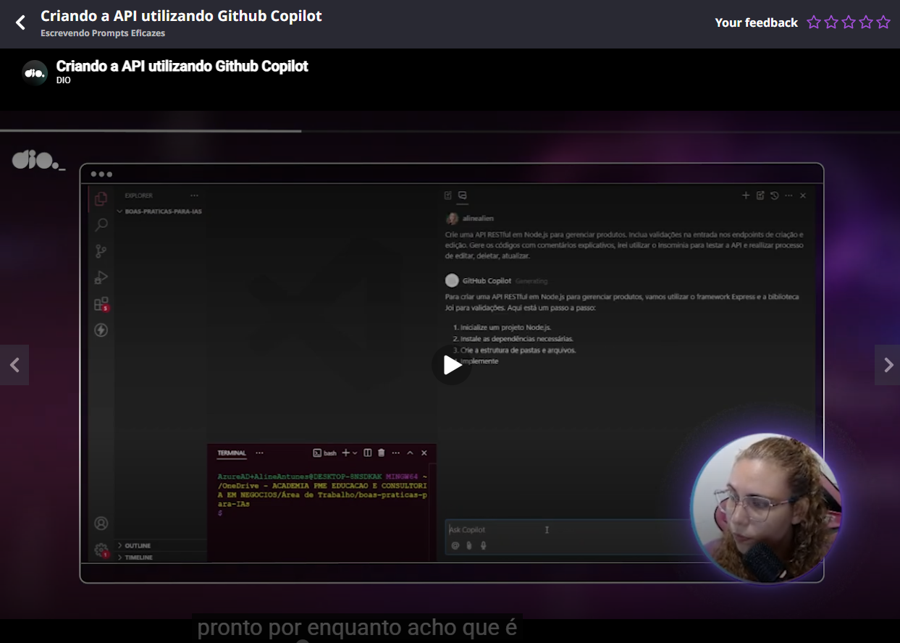

Process:

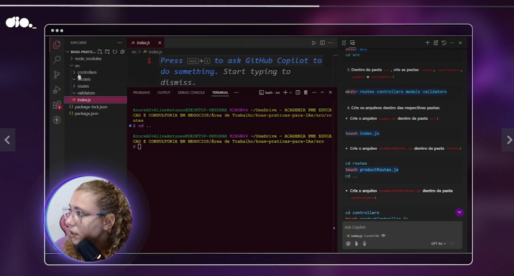


# Asking Github Copilot to a help in a file

Please press **Ctrl+I** then you will see an area to submit your help request.

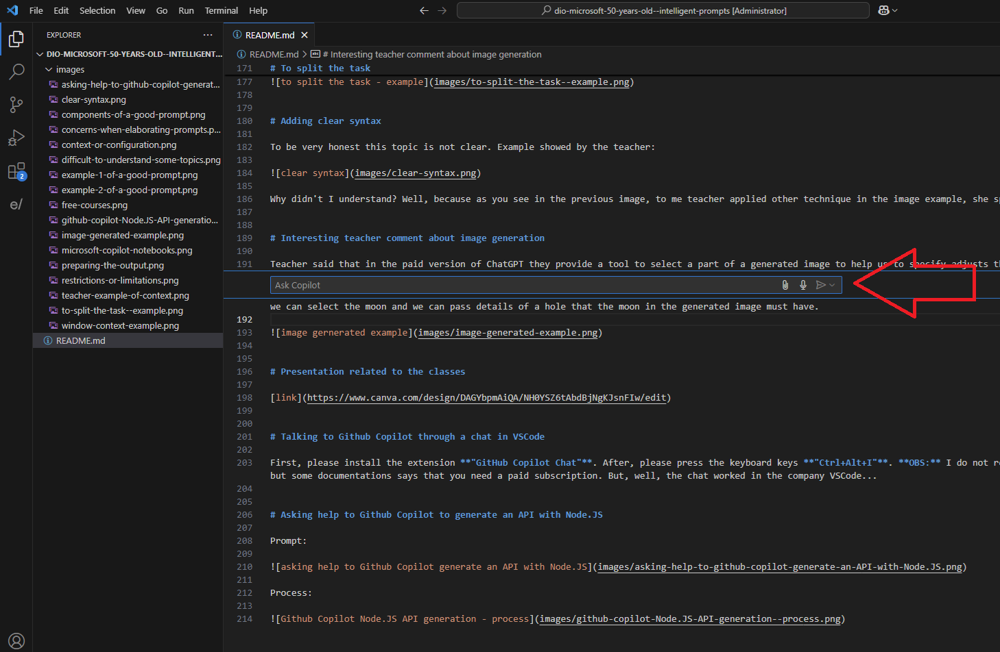


# General process on the teacher test project

- The general process was ask the API to manage products with Node.JS creation;
- Teacher also asked the Github Copilot through the chat to instruct her to install and test the API with Insomnia;
- Teacher had to create the files, but got the source code from the Github Copilot answer;
- In a file, teacher asked Github Copilot through a help request in a file to insert comment codes in the source code.


# Generating documentation

Teacher created a README.md file and inside the file pressed the combination of keys &lt;CTRL+i&gt; to open the **"Ask Copilot** dialog box and there she asked Google Copilot to generate a documentation:

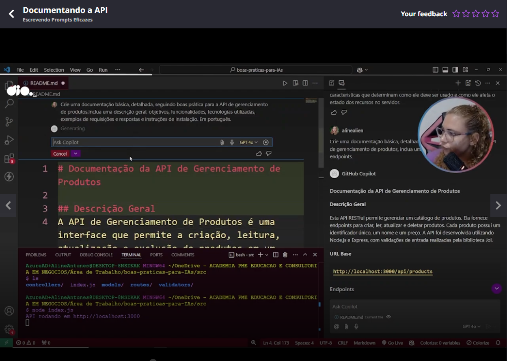

And GIthub Copilot didn't generate the answer in the chat. It generated the documentation directly in the file.


# Repository related to the classes of the course "Writing effective prompts"

[link](https://github.com/alinealien/boas-praticas-para-IAs)


# Courses indicated by the teacher in the DIO platform

- AI 102 formation (Microsoft);
- Bootcamp Github Copilot.


# "Construindo Soluções Inteligentes com IA e Azure Cloud" lecture

Azure AI services:

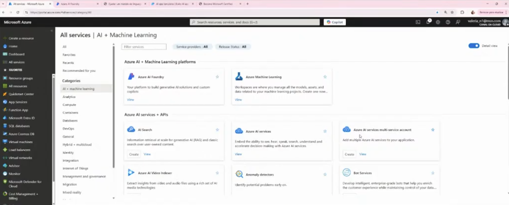

In this portal Microsoft consolidates several projects related to AI, as example services, related to images, bot services, AI search and others.

Azure Foundry:

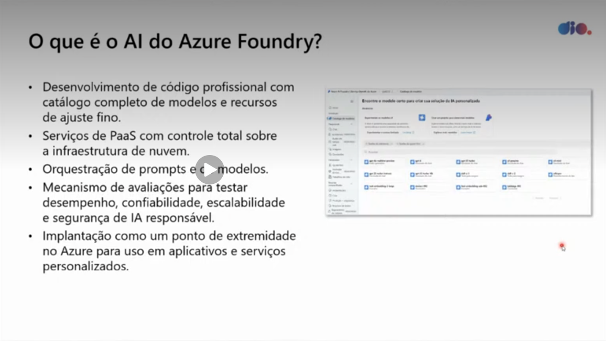

Azure Foundry portal - hub of Azure AI services:

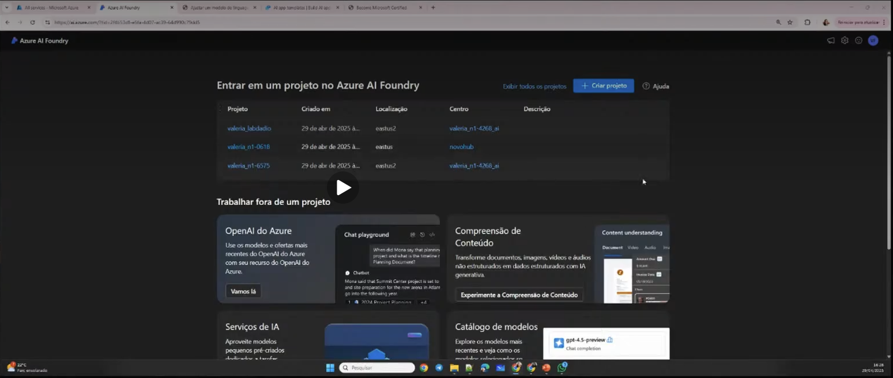

The presenter said that is important to remove greets to prompts to be passed to chatbots, because these words are unnecessary to solve the doubth and will be processed.

Teacher said that is important that more that one person has access to a resource, to avoid problems like demission of this person.


## Cloud services - RBAC

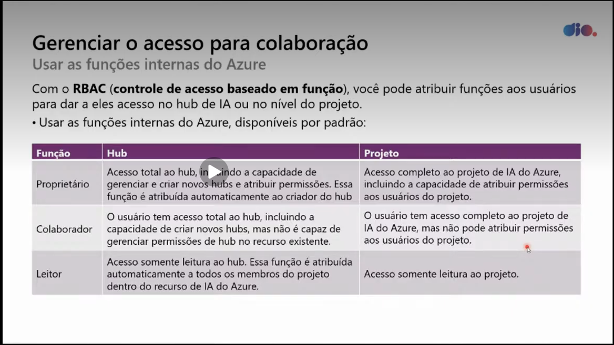

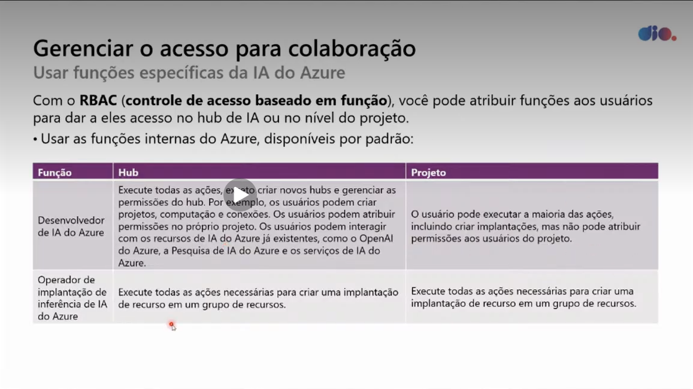


## Microsoft certifications

See in the image that there is a "Data and AI" area:

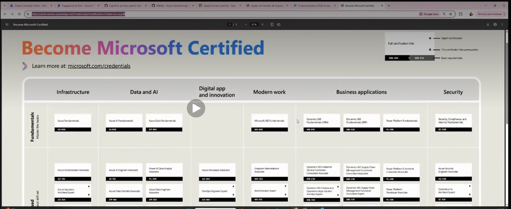

**OBS:** teacher said that "-900" certifications:
- like "AZ-900" or "AI-900";
- has no expiration date;
- are introdutory certifications;
- has no laboratories.

Related to some other certifications, teacher said that they are valid for 1 year, but **when renewing the certification** you can take the test from home, without a surveillance of a people or machine monitor, searching for information during the test on Internet.

Teacher explained that **you have to renew a Microsoft certification before the epiration date**. Without renewing you will loose all benefits as can read documents during the test and take the test from your home.

[The Microsoft Credentials website](https://learn.microsoft.com/en-us/credentials/) seems **very** interesting.

